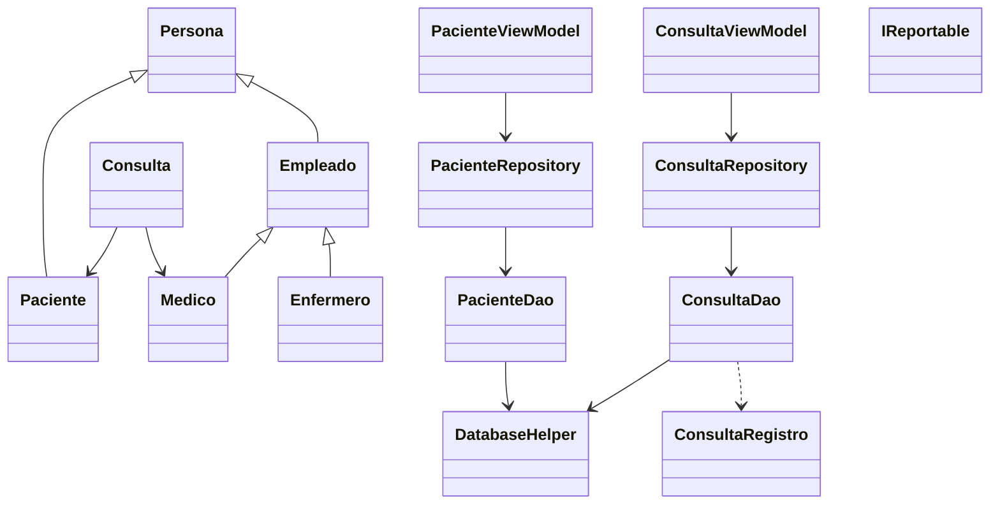

# Diagrama UML de clases (núcleo persistente)

Las clases `ConsultaRegistro` representan la proyección persistida de las citas; `Consulta` es la entidad original de dominio. Revisar la interfaz `IReportable` y su implementación para explicarla en la exposición.
